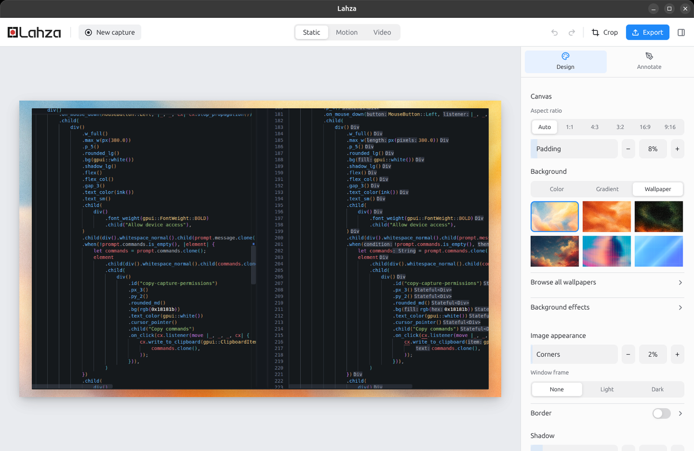
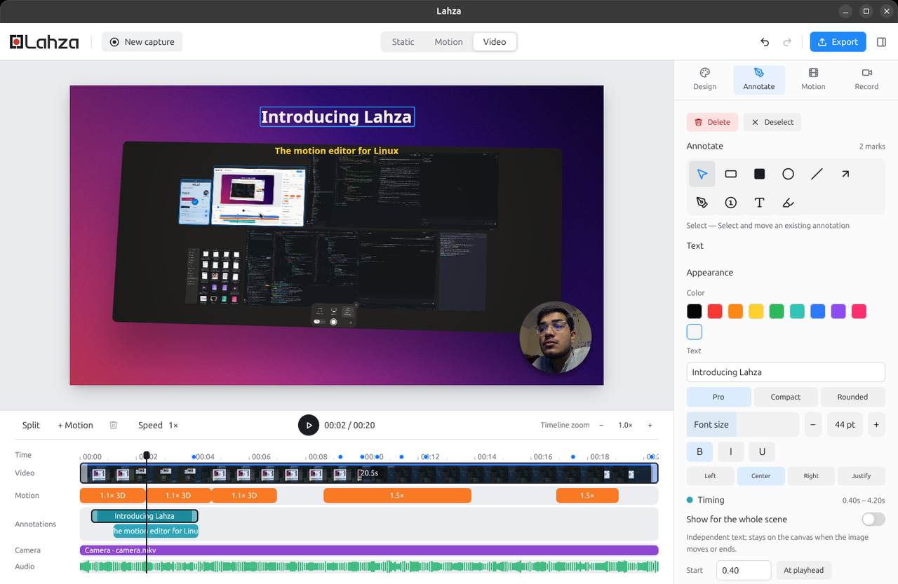
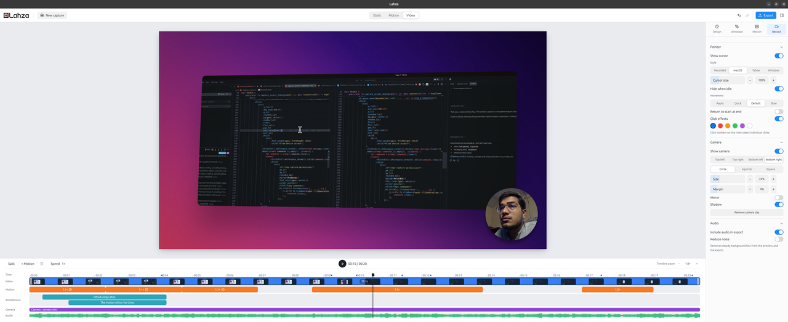
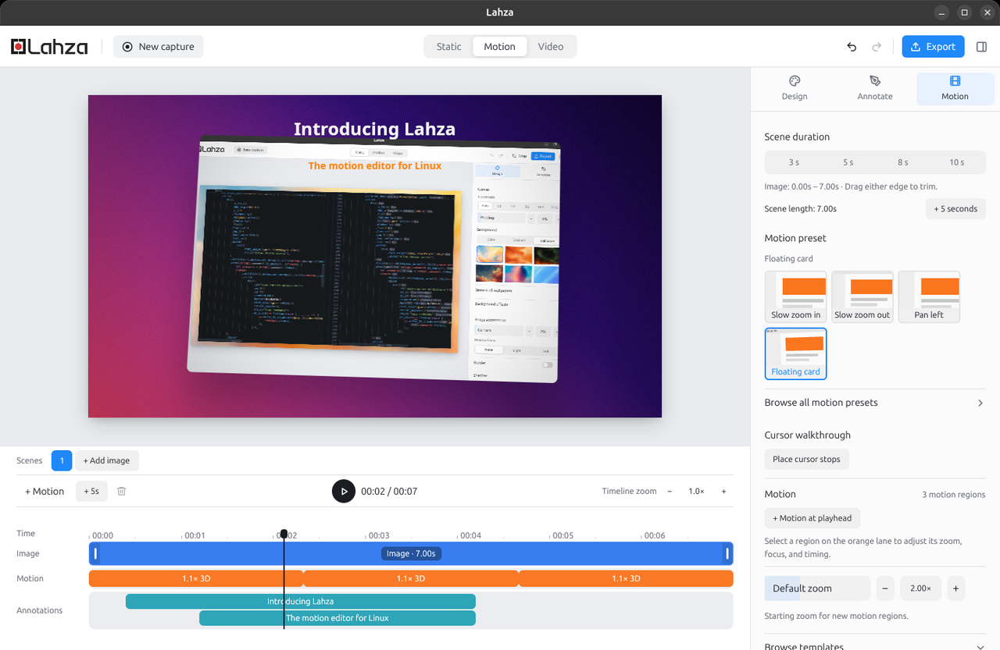
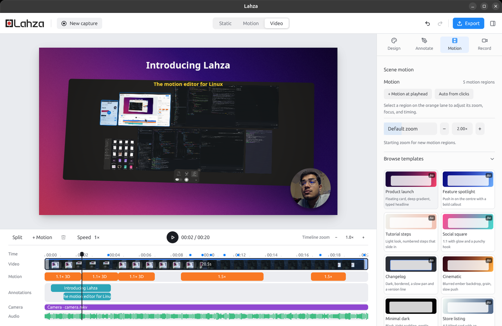
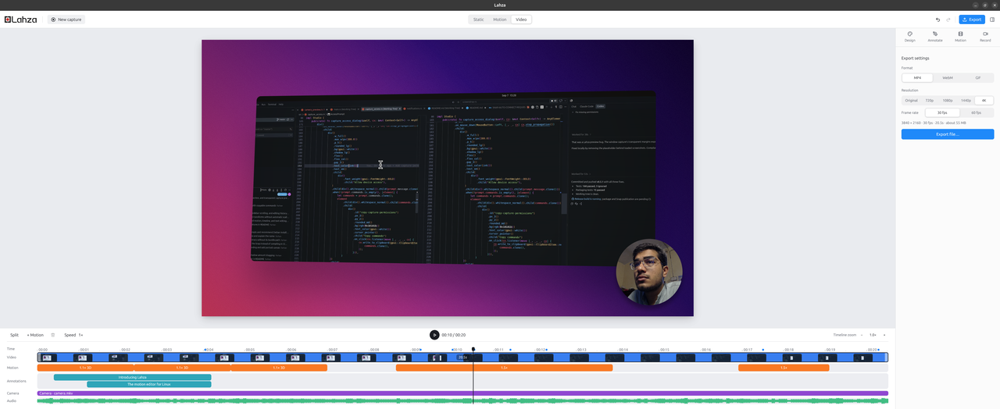

<div align="center">
  
  <h1>Lahza · لحظہ</h1>
  <p><em>Lahza</em> is Urdu for "a brief moment".</p>
  <p>A native Linux studio for screenshots, screen recordings, and motion.</p>
  <p>Capture a moment. Annotate it, style it, and turn it into something worth sharing.</p>
  <p><a href="#install">Install</a> · <a href="https://github.com/FarhanAliRaza/lahza/releases">All downloads</a> · <a href="https://github.com/FarhanAliRaza/lahza/issues">Report a bug</a> · <a href="#build-from-source">Build from source</a></p>
</div>

Built with Rust and GPUI, Lahza brings screenshot annotation, native screen recording, timeline editing, and animated presentations into one Linux desktop application.

## Install

### Debian / Ubuntu

Download the `.deb` for Ubuntu 24.04 amd64 from [GitHub Releases](https://github.com/FarhanAliRaza/lahza/releases), then run:

```bash
sudo apt install ./lahza_0.5.9_amd64.deb
```

### Snap

```bash
sudo snap install lahza
```

[Permissions, updates, and troubleshooting](#installation-details)

## Features

### Capture and record

Capture screens, windows, or areas. Record with system and microphone audio, pause and resume, and save editable projects with autosave.

### Design the scene

[](packaging/store/screenshots/01-screenshot-styling.png)

Style your captures with backgrounds, rounded corners, shadows, and window frames. Add effects and watermarks, adjust 3D perspective, and save reusable presets.

### Annotate screenshots and videos

Annotations move and resize freely by default. Hold **Ctrl** to align with
image/canvas guides while moving or resizing.



Add arrows, shapes, text, numbered steps, and highlights. Blur sensitive details, crop screenshots, and animate annotations with custom timing.

### Edit recordings

[](packaging/store/screenshots/03-video-and-camera.png)

Trim, split, and change clip speed. Add zooms, pans, 3D motion, and camera overlays. Customize cursor effects and generate click-based zooms when input metadata is available.

Transcribe the narration on this computer into subtitles with an optional spoken-word highlight, then cut footage by transcript: select words, remove filler words, or trim long pauses. Show typed keystrokes and a speed badge on sped-up clips, and drag the camera bubble anywhere with snap guides.

### Animate still images

[](packaging/store/screenshots/02-motion-and-captions.png)

Turn screenshots into animated scenes with zoom, pan, and 3D presets. Combine images, timed captions, and cursor walkthroughs.

### Start from a template



Start with ready-made layouts for product launches, tutorials, social posts, changelogs, and more. Customize their styling, motion, and captions.

### Export

[](packaging/store/screenshots/04-export-formats.png)

Save screenshots as **PNG** and videos or animations as **MP4** (H.264 or HEVC), **WebM**, or **GIF**. Export up to **4K** at **30 or 60 fps**, with optional motion blur, size estimates and progress tracking. Fixed-aspect canvases such as 9:16 or 4:5 can **Fill** the frame with a camera that follows the cursor. Export the mixed audio alone as **M4A** or **WAV**, subtitles as **SRT**, or upload to your own share server and copy the link.

## Quick start

1. Launch Lahza and choose **Screenshot** or **Record screen**.
2. Use **Design** to style the scene and **Annotate** to add marks.
3. Select **Motion** for zooms, pans, transforms, or screenshot animation. Add a motion region at the playhead or double-click the orange lane, then select it to edit its focus and timing.
4. Use **Export** to choose an output format and save the result.

To record part of a screen, choose **Selected area** in the capture launcher,
then **Record area**. Choose the screen in the system picker, drag a rectangle
on its preview, and click **Start recording** (or press Enter). Use **Size** for
an exact 720p, 1080p, 1440p, or 4K capture, or **Shape** to draw in 16:9, 9:16,
1:1, or 4:3. Each shape starts at the largest size that fits the screen, so
switching shapes does not progressively shrink the selection. Sizes larger
than the selected screen are disabled. Drag inside
the selection to move it; in Free or a shape mode, Shift-drag draws a new area.
The displayed dimensions are capture pixels, independent of desktop scaling.
Escape or **Cancel** exits without starting a recording. Only the selected rectangle is
encoded, including when you pause and resume. Area recordings include the
system cursor; editable cursor effects and automatic click zooms are unavailable
in this mode.

While an area recording is active, a click-through red border marks its desktop
bounds. The border turns amber when paused and disappears when recording ends.
It uses X11/XWayland and is drawn outside the capture so it does not appear in
the saved video. Edges flush with a monitor boundary may be off-screen.

With the media selected, drag to move, **Shift-drag** to tilt, **Ctrl-drag** to spin, scroll to scale, and double-click to reset.

## Build from source

Install a Rust toolchain with Cargo and the native dependencies. On Ubuntu:

```bash
sudo apt update
sudo apt install -y build-essential pkg-config libclang-dev \
  libgstreamer1.0-dev libgstreamer-plugins-base1.0-dev \
  libpipewire-0.3-dev libspa-0.2-dev \
  libxkbcommon-dev libxkbcommon-x11-dev \
  ffmpeg gstreamer1.0-tools gstreamer1.0-libav gstreamer1.0-pipewire \
  gstreamer1.0-plugins-base-apps gstreamer1.0-plugins-good \
  gstreamer1.0-plugins-bad xdg-desktop-portal desktop-file-utils

git clone https://github.com/FarhanAliRaza/lahza.git
cd lahza
cargo build --release --locked
```

For a desktop install, use `just install-desktop` if you have [just](https://github.com/casey/just), or run:

```bash
install -Dm755 target/release/lahza ~/.local/bin/lahza
install -Dm644 packaging/com.lahza.Lahza.desktop \
  ~/.local/share/applications/com.lahza.Lahza.desktop
install -Dm644 assets/Lahza.png \
  ~/.local/share/icons/hicolor/512x512/apps/com.lahza.Lahza.png
update-desktop-database ~/.local/share/applications
gtk-update-icon-cache -t ~/.local/share/icons/hicolor
```

Ensure `~/.local/bin` is on `PATH`. After later changes, `just install` rebuilds and replaces the installed executable, stopping any running instance; `just run` also launches it. On GNOME, these commands also install the capture helper and configure it to enable at login. A newly installed or updated helper needs a logout/login before use; restarting Lahza alone is not enough. For development without installing, use `cargo run`.

### GNOME capture helper

The bundled GNOME Shell extension keeps the teleprompter visible on your desktop
but out of screen and area recordings. It also supplies additional pointer/click
metadata and modifier/special-key captions. It supports GNOME 48–50.

For a source checkout, run `just install-helper` to install only the helper
without rebuilding or stopping Lahza. `just install` and `just run` include this
step automatically. The installer preserves your other extensions and reports
when a logout/login is needed.

To install the bundle manually:

```bash
gnome-extensions pack --force --extra-source=prompter.js --out-dir /tmp packaging/gnome-shell-extension
gnome-extensions install --force \
  /tmp/lahza-input@com.lahza.shell-extension.zip
```

On a first installation, log out and back in so GNOME Shell discovers the
extension, then run `gnome-extensions enable lahza-input@com.lahza`. After updating
an already loaded version, log out and back in to load the new code.

The helper acts only on Lahza's active capture requests. Plain typed text is not
logged. Ordinary recordings and teleprompter window recordings work without the
helper; screen/area recording with a teleprompter waits for confirmed exclusion
before encoding. Editable pointer effects and automatic click zooms depend on
available input metadata.

### Source layout

`src/main.rs` owns application startup, shared Studio state, and editor coordination. Editor behavior is split by responsibility:

- [`crates/annotations`](crates/annotations): shared annotation models, geometry, snapping, text layout, painting, export, and animation, with its own fonts and fixtures.
- `models.rs`: crop, scene, and timeline editing data types.
- `annotations.rs` and `timed.rs`: connect the annotation crate to Studio input, selection, undo, and video timing.
- `crop.rs`: crop editing operations and painting.
- `capture.rs`: recording lifecycle, project loading, and screenshot capture.
- `video.rs`: timeline editing and playback.
- `controls.rs`, `preview.rs`, and `launcher.rs`: editor controls, canvas layout, and launcher UI.
- `theme.rs`: shared colors, branding, and background presets.

The existing `recording/` modules own media processing and persistence. Keep new editor features in the module that owns their behavior; use explicit imports and limit helper visibility to the callers that need it.

### Development checks

```bash
cargo check --locked --workspace
cargo test --release --locked --workspace
# Annotation engine only:
cargo test --locked -p lahza-annotations
```

Export integration tests require FFmpeg/FFprobe. Desktop capture and playback also need manual testing in a real Linux desktop session.

### GPU export composition

Exports automatically select a hardware Vulkan GPU, preferring a discrete GPU.
NVIDIA and AMD use the same compositor for media transforms and cropping,
rounded masks, webcam layers, cursor effects, captions, and watermark blending.
The export panel reports **Composition** and **Encoding** separately: hardware
composition can also run with a software video encoder. If Vulkan is unavailable
or fails, the current frame and remaining export use the CPU compositor.

Decoding, text/vector rasterization, and preparation of cached backgrounds and
shadows still run on the CPU. Composed frames are read back for the existing
FFmpeg encoder; this is not a zero-copy decoding-to-encoding pipeline.

For troubleshooting or comparison, launch with `LAHZA_COMPOSITOR=cpu` to force
CPU composition. The shader validation and CPU fallback tests run in the normal
suite. On a machine with a working NVIDIA/AMD Vulkan driver, run:

```bash
cargo test --release --locked hardware_composition_matches_cpu -- --ignored --nocapture
cargo test --release --locked benchmark_hardware_composition -- --ignored --nocapture
# Export a 20-second sample to a temporary directory without editing the project:
LAHZA_EXPORT_PROJECT=/path/to/project.lahzarec cargo test --release --locked benchmark_saved_recording_export -- --ignored --nocapture
```

## First-release scope

Lahza is an early Linux release. Desktop portal behavior varies by compositor, and the presence of both display backends does not imply every capture feature has been validated on every desktop. Live webcam capture depends on camera permissions and a supported V4L2 device. Recovery can salvage usable recordings, but cannot guarantee recovery after every encoder or system failure.

See [the engineering parity checklist](docs/VIDEO_PARITY.md) for deeper implementation notes and outstanding work. Some checklist entries track broader parity requirements, rather than whether an individual control exists.

## Contributing and reporting issues

Bug reports and focused pull requests are welcome. Include your distribution, desktop environment, Wayland/X11 session, Lahza version, steps to reproduce, and relevant terminal output. Review screenshots, recordings, and logs for private information before attaching them.

The application declares the **MIT** license in `Cargo.toml`.

## Installation details

Launch **Lahza** from your application menu. For the Debian package, you can also run `lahza`.

### Debian updates and troubleshooting

Debian packages built from this source include a terminal updater:

```bash
lahza-update --check
lahza-update --install
```

It checks the latest stable GitHub Release, downloads a newer package for your architecture, verifies its release SHA256 checksum and package metadata, and runs `sudo apt install`. APT asks for confirmation. Save your work and fully quit and reopen Lahza after installation. Checksums verify download integrity against the release; they are not independent signatures. The updater requires internet access and manages Debian installations only.

Existing 0.4.1 packages do not contain this command. Until you install a release containing it, you can run `python3 packaging/lahza-update --install` from this source checkout, or download a newer `.deb` and use `sudo apt install ./<downloaded-file>.deb`. Installing a local `.deb` does not subscribe APT to GitHub Releases; automatic updates through `apt upgrade` would require a separately hosted APT repository.

If the old app still opens, check for multiple installations:

```bash
type -a lahza
dpkg-query -W lahza
/usr/bin/lahza
```

A source or bundle install in `~/.local/bin/lahza` can take precedence over `/usr/bin/lahza`. A user launcher at `~/.local/share/applications/com.lahza.Lahza.desktop` also overrides the system launcher. Back up or remove those old local installation files if you want to use only the Debian package. New Debian package launchers explicitly select `/usr/bin/lahza`; an existing user launcher still takes precedence. New builds support `lahza --version` to identify the executable's version.

The `_apt` “unsandboxed as root” notice for an unreadable Downloads directory does not mean installation failed. The updater uses an APT-readable temporary download directory. Installing a package system-wide requires `sudo`; repeating the same version does not fetch a newer GitHub release.

For maintainers: update and commit the release notes on `master`, then run `just release` to bump the patch version and push a release tag. Pass a version such as `0.5.0` to choose it explicitly, or use `just release-check` to preview. See [release instructions](packaging/SNAP.md#cut-a-release). The release workflow validates the tag and publishes the `.deb` and `SHA256SUMS` consumed by the updater. Do not replace old release assets with changed builds under the same version.

Debian packages and binary bundles are built on **Ubuntu 24.04, amd64**. Compatibility with older distributions is not guaranteed; use the Snap or build from source if the package's dependencies are unavailable.

The release workflow also builds and tests a `core24` Snap. Matching version
tags publish it to the Snap Store after both package jobs pass (stable versions
to `stable`, prerelease versions to `beta`). Maintainers must first configure
the Store credential using the [Snap release setup](packaging/SNAP.md#github-actions-releases).

### Snap permissions and updates

The Snap requires [snapd](https://snapcraft.io/docs/installing-snapd) and extra camera and audio-recording permission setup. The Debian package uses normal desktop device access without these additional Snap connections.

Launch **Lahza** from your application menu, or run:

```bash
snap run lahza
```

The Snap bundles its desktop and media dependencies and receives automatic updates through snapd. To check for an update manually, close Lahza and run:

```bash
sudo snap refresh lahza
```

When camera or audio recording access is missing, Lahza shows an **Allow device
access** prompt with the commands needed to enable access. Choose **Copy commands**,
paste and run them in Terminal, then return and choose **Try again**. Device lists refresh
without restarting. See [Snap setup](packaging/SNAP.md) for troubleshooting.

To save files on removable drives, also run `sudo snap connect lahza:removable-media`.

**Previously installed a local test `.snap`?** Switch it to the Store version once to enable normal updates:

```bash
sudo snap refresh lahza --amend --channel=stable
```

Use `snap info lahza` to compare the installed version with the Store channels. If you also have a Debian or source installation, `snap run lahza` explicitly launches the Snap.

### Binary bundle — alternative

Each release also includes `lahza-0.5.9-linux-x86_64.tar.gz`, containing the executable, assets, and a user-local installer:

```bash
tar -xzf lahza-0.5.9-linux-x86_64.tar.gz
cd lahza-0.5.9-linux-x86_64
./install.sh
```

The installer adds the binary, assets, desktop entry, and icon under `~/.local`. Ensure `~/.local/bin` is on `PATH`. Run `./install.sh --help` for details. The bundle requires system libraries and is built on Ubuntu 24.04; it is not a static build. The release notes list runtime dependencies. `SHA256SUMS` accompanies both downloads for integrity verification.

### Desktop requirements

- A Linux desktop with Vulkan support. Wayland and X11 backends are compiled in.
- `xdg-desktop-portal` and the appropriate portal backend for your desktop.
- PipeWire for desktop capture. The Snap bundles GStreamer, FFmpeg, and FFprobe; Debian and source installations use system media libraries and tools.
- Desktop support for the screenshot and screencast portals. Picker options depend on your desktop.

### Optional tools

- `whisper.cpp` (`sudo apt install whisper.cpp`) enables on-device subtitle
  transcription and the teleprompter's voice following. The speech model
  (148 MB, or 488 MB for the accurate one) downloads on first use into
  `~/.local/share/lahza/models`.
- `curl` is used to download speech models and to upload to a share server.

### Timeline editing

Drag the ruler to preview frames as you scrub. **Skim** previews a hovered moment
without moving the playhead; leaving the timeline restores the parked frame.
**Follow** keeps playback visible, and pauses following when you scroll manually.

Use **Fit** (Ctrl+0) to show the full edit, or Ctrl+plus/minus to zoom around the
visible playhead. Ctrl+wheel zooms around the pointer. The horizontal scrollbar
pans the timeline. Drag the divider above the controls
to resize the panel; stacked tracks scroll vertically, with Shift+wheel for
horizontal movement. Arrow keys make fine seeks; Shift+arrows move one second,
and Home/End jump to the beginning/end.

Drag clip edges to trim, or a clip body to move it. **Snap** (N) aligns edits to
the playhead and other boundaries and shows a guide. Esc cancels the active
edit. Right-click a clip for split, speed, and deletion; right-click motion for
its options. Drag across an empty motion lane to create a region of that length.
Undo restores the selected clip and playhead as well as the edit.

### Subtitles and transcript editing

Open **Record → Subtitles** and choose **Transcribe narration**. Captions follow
every clip edit. **Edit transcript** opens a panel where clicking a word seeks to
it, Shift-click selects a range, and **Cut word**, **Remove fillers** and **Trim
pauses** remove footage. A cut also removes the cut words from captions you have
not edited, and both undo together. Click a caption's time to edit its text.
**Export .srt…** saves subtitles for the edited timeline.

### Floating recording controls

With **Lahza Capture Helper** active on GNOME, starting a recording shows a
draggable pill with elapsed time, pause/resume, and stop/save controls. The
launcher minimizes before capture starts. If the camera is enabled, a separate
draggable webcam preview appears near the bottom-right. After selecting a monitor
in the system picker, both overlays move onto that monitor; pausing and resuming
preserve any placement you adjust during the take.

Both floating windows are excluded from the screen recording. Webcam footage
is recorded separately and remains editable; moving its preview does not change
the camera's position in the finished video. The preview is marked paused while
capture is paused. Stopping, including through GNOME's screen-sharing stop
control, saves the take, closes both windows, and opens the editor.

If the helper cannot protect these windows, they close before capture starts
and the launcher keeps its existing recording controls. If protection is lost
during a take, the floating windows close and the launcher returns.

### Teleprompter

Turn on **Teleprompter** in the recorder, then open or paste a script. While
recording, the prompter floats at the top of the main screen. With whisper.cpp,
the voice model and the microphone on, it scrolls as you read; otherwise scroll
it with the mouse wheel or click a word.

With the [GNOME capture helper](#gnome-capture-helper), the prompter is omitted
from screen and selected-area recordings while remaining visible on your
desktop. The content underneath stays live in the video. Lahza waits for the
helper to protect the prompter before encoding; if protection is unavailable,
it reports an error instead of recording the script. Window capture works
without the helper.

Teleprompter settings stay fixed during a take, including pause and resume;
restarting resets the script inside the same protected window. Disabling the
helper closes the prompter; its exclusion stays in place until the window is
destroyed, so the script is not briefly exposed in the recording.

### Sharing

**Export → Share** uploads the current edit to a Screendrop-compatible upload
worker and copies the share link. Enter the server address and upload token
once; they are stored in `~/.config/lahza/cloud.json`, readable only by you. The
share page receives a poster, a storyboard and the transcript.

### Imported timeline media

In the recording editor, use **+ Image / video** to append a video or a five-second
still-image clip. Imported clips use the existing trim, split, speed, move, and
motion controls. Imports are stored inside the project; the original screen
recording is preserved. Import copies only the new asset and updates a small
media index; existing footage is never re-encoded during import. Images remain
still files. Playback and export combine the separate assets on demand.

Use **+ Image overlay** for an image that appears over the recording. Select it to
move or resize it, then use the annotation timing controls for its start/end and
entrance/exit animation. Transparent PNGs are supported, and overlay pixels are
embedded in the saved annotation.

Use **+ Audio** to add music or a sound effect at the playhead. The **Record → Audio**
panel controls each layer's volume, placement, trimming, and fades. Multiple layers
mix with the recording in preview and MP4/WebM export. The recording can be muted
independently. Audio layers retain their editor-time positions when video clips
are edited; audio beyond the end of the video is clipped. Audio edits support
undo/redo and are saved with the project.
