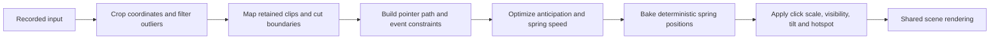

# Screen Studio 4.1 animation study

Inspection date: 2026-10-25. Target: the user-supplied `Screen Studio 4.1.0-5005 Intel.dmg`.

Screen Studio's polished motion comes from three separate systems: a cursor path
planner that anticipates important input events, a camera target that groups
pointer activity into stable regions, and springs that animate the resulting
targets. Changing a single easing curve does not reproduce that behavior.

This study used REA to identify, inventory, extract, and statically analyze the
shipped Electron application. Rotating string tables were decoded as data and
the relevant bundled functions inspected. The macOS application was not run.
The algorithms below are static code observations; visual fidelity, actual
first-launch settings, and native runtime behavior remain unverified.

## Artifact and evidence

| Artifact | SHA-256 |
| --- | --- |
| Supplied DMG | `52da4f405da480872c3e2b76253445657d4a001e1aec2608336df9a6136169a1` |
| Extracted `app.asar` | `69a28dbaca31fcf54bf0249019a9aaaed932525b77f6eec04691c1536a022876` |
| `dist/B39sgn5K.js` (renderer/planners) | `38e2ee5bc837286b13ab3fc0fd598ee24949589a8101bceb5728030b371c2e99` |
| `dist/CpXpNcFh.js` (springs) | `163132f3d4d94e90f1afb6cc97f3cf0c1cb4993859535fabfee4efe1cc1d108f` |
| `dist/Brm6UpoL2.js` (animation settings) | `48887effccbd942f05b530d4885c79ad996c6e61bcd0a3f0571e25c5860b24c3` |
| `dist/DXXvn2Sd2.js` (zoom generation/model) | `94a16ea090c633a55408e007bf025196505e622d3853e9c40b07f4b5d152e71a` |
| `dist/DgH-sR-Y2.js` (project configuration) | `4a9a1a3467708e404cf7f92576a939b6de09f05693353272e435484df8fc3e26` |

REA evidence references:

- DMG inspection: `ev_811427be99d08bafbe5701ad417f439b35648b6e093b4f89aa1e0b85cab0f34d`.
  On Linux this established root identity only. A temporary unpacked 7-Zip
  26.00 package extracted the ASAR and companion files without mounting or
  launching the target.
- ASAR inventory: `ev_df86281aee6c46e370f73f6d1fadd6d95c4e0cf6d5fc463077aa253fcfdcf9ca`.
- REA extraction: `ev_6119addd8da69972e858063eb3cfec18daf5d23787c35bca26a41ce8bc7d8fd5`.
- Spring/settings analysis: `ev_ad00cfded95cd4fc2614181741083b543ac28cdc3faaa679ed5c2d49cb812cba`.
- Renderer/zoom analysis: `ev_4f07355e6db3ba6bf1b8027bbac9e19143cff4ccd7d6af92e46eb88ba2d8cbfb`.
- Camera/recording UI analysis: `ev_715a12bba718dbb9544f7c2d1643e7cba91b58dfb4a9ce0e60d6e26c55b07448`;
  summary `ev_4f25f75c752d74173bbf062ae98d5e9800c4d8144b4638b81a97cafe3e862056`.

The full REA ledger is saved locally in
`ignore/screenstudio-4.1.0-evidence.json`; the second UI analysis bundle is
`ignore/screenstudio-4.1.0-ui-evidence.json`. Both are deliberately outside
version control. Exact source spans and inspection notes are retained under
`ignore/screenstudio-analysis/`. Ranges in this document are zero-based UTF-8
bytes, with exclusive ends, in the original bundled files.

Coverage is bounded to selected JavaScript modules. The larger semantic graph
hit configured node/unknown limits, so it is not a complete application call
graph. Eight unpacked native executables/addons differ from their ASAR-declared
hashes. REA preserved those contradictions with `record-and-continue`; their
behavior is outside these conclusions. The animation JavaScript cited here was
not among those mismatches. Static decoding and manual tracing supplement the
REA syntax evidence; the ledger alone does not prove runtime reachability.

## Cursor algorithm

The planner in `B39sgn5K.js` bytes `[177490,205738)` does the following:

1. Build a piecewise path. Interpolate neighboring samples separated by at most
   40 ms; hold position across longer gaps.
2. Set accuracy constraints at input events: clicks and drags use a 2 px
   tolerance, hover changes 4 px, and cursor-image changes 6 px. Group constraints
   separated by at most 100 ms.
3. Search anticipation from 0 to 600 ms and spring speed multipliers from 1 to
   32. Simulate candidates, preferring modest changes when they bring the worst
   error/tolerance ratio to 0.75 or below. Groups within 400 ms can merge when
   satisfying them separately is difficult.
4. Increase anticipation during preceding rests when possible. Otherwise ramp
   it through a bounded compression window. Prevent anticipation from crossing
   the next cut. Blend speed changes over approximately 250 ms entering and
   300 ms leaving, in logarithmic space.
5. Bake positions with 1 ms spring integration. Resting spans are compressed;
   moving spans use numeric arrays, with interpolation for fractional times.
   Chunk caches avoid recomputing the entire recording on each seek.

This anticipates the recorded path under accuracy constraints. It is more
involved than snapping toward the next click a fixed time before it happens.
The source expresses a solver objective; it does not establish that every
possible recording meets every tolerance.

The motion equation is the standard damped spring:

`acceleration = (stiffness * (target - position) - damping * velocity) / mass`

Velocity is integrated before position. A speed multiplier `s` scales stiffness
by `s²` and damping by `s`, leaving mass unchanged. When moving toward the target
too quickly, damping increases toward critical damping
`2 * sqrt(mass * stiffness)`. See `CpXpNcFh.js` bytes `[10584,13586)` and the
cursor planner's specialized integration. This is physical parameter tuning,
not a cubic-bezier curve.

| Named preset | Stiffness | Damping | Mass |
| --- | ---: | ---: | ---: |
| Cursor Smooth | 470 | 70 | 3 |
| Cursor Medium | 340 | 60 | 3 |
| Cursor Rapid | 530 | 40 | 1 |
| Camera Focused | 250 | 40 | 2.25 |
| Camera Smooth | 170 | 50 | 3 |

Preset definitions: `CpXpNcFh.js` `[25069,25742)` and
`Brm6UpoL2.js` `[9900,10414)`. Cursor None disables smoothing. These are named
choices, not proof of the settings a fresh installation selects. Shared schema
fallbacks also contain stiffness 125, damping 12, mass 1.5; saved project data
can override them.

Other cursor details:

- Click size targets 90% while pressed, then 100%, using the selected spring.
  Idle hiding fades opacity while introducing blur with radius target 10.
  A separate typing detector can hide the cursor after at least three key-down
  events in 1800 ms without newer pointer activity. Sources: renderer
  `[561360,564474)` and `[254434,255177)`.
- Mild tilt uses smoothed horizontal velocity, a 120 ms smoothing time, and a
  ±20° limit. Directional rotation is a separate behavior, not just stronger
  tilt. Source: renderer `[108827,117422)`.
- The optional 500 px outlier threshold rejects isolated jumps compared with
  two following samples. It is not the camera dead zone. Source: renderer
  `[92425,92983)`.
- The hotspot is transformed through crop/zoom separately from cursor artwork
  size and rotation. Source: renderer `[266601,267245)`.

## Zoom and editor behavior

Automatic click zoom in `DXXvn2Sd2.js` `[38663,39990)` uses a 2× zoom, starting
300 ms before a click and ending 2500 ms after it. Clicks in the final second
are excluded, ends stop 800 ms before the recording ends, and nearby ranges
merge across gaps of up to 2500 ms. This long merge window explains why a series
of clicks can remain in one continuous zoom.

The camera follows stable groups of activity. Pointer travel is reduced to
roughly 10 px steps while retaining button events. Samples join a group while
their bounding box fits within half the visible source area at the selected
zoom. The center is weighted by dwell time. Tiny pointer movements therefore
do not continuously pull the camera around. Sources: renderer
`[91251,91843)`, `[92983,93490)`, `[101330,103795)`, and `[294784,296208)`.

Zoom selection and spring animation are separate. An optional Start animation
early setting adds a 350 ms lead, but its schema default is false. Instant zoom
regions bypass the spring. Their snap window lasts through 50 ms after the end
so the camera returns immediately; this does not extend the visible region. Sources: configuration `[120065,121004)` and
renderer `[56721,57640)`, `[294536,294784)`, `[305478,310556)`.

The selected zoom inspector has a specific hierarchy in `DcSzqHBq.js`
`[6513,9921)`, observed in the ordered React children:

1. **Zoom style**: a large **Classic / Glass Loupe** selector.
2. A conditional control: **Instant animation** for Classic, or **Glass Loupe
   size** for Loupe.
3. **Zoom position**: **Auto / Manual**, when automatic zoom is supported.
   Manual reveals a dot-picker preview at the region's start with the source
   crop applied. Auto explains that the camera keeps the cursor visible.
4. **Zoom level**: a 100–400% slider with a reset value.
5. **Advanced**: a togglable section containing **Start animation early**.
   Its explanation explicitly says this applies to every zoom in the project.
6. A secondary **Remove** action.

| UI evidence | Original module and UTF-8 byte span |
| --- | --- |
| Hero presentation selector and labels | `DcSzqHBq.js` `[4547,5122)` |
| Auto/Manual options and descriptions | `DcSzqHBq.js` `[5262,6195)` |
| Conditional controls and inspector order | `DcSzqHBq.js` `[6513,9921)` |
| Size slider literal `'min':0.25,'max':0.75` | `DcSzqHBq.js` `[7873,7895)` |
| Disabled optional glass-control placeholders `z=!0x1,B=!0x1` | `DcSzqHBq.js` `[6499,6512)` |
| Add zoom opens `sidebarItem` of type `zoom` | `BbPLqgNs2.js` `[4893,6238)` |
| Remove, Auto/Manual, Disable, and Duplicate actions | `BbPLqgNs2.js` `[8208,10384)` |
| Apply zoom level to all other zooms, updating only `zoom` | `BbPLqgNs2.js` `[11956,12456)` |

The reference does not expose bevel or chromatic-aberration controls in this
inspector. Its bulk action changes zoom level, not every style field. The
Advanced section is explicitly togglable; its initial expansion state is not
established by the inspected call site.

Project animation settings are separate from this selected-region editor.
`Brsq8wl5.js` `[28301,28751)` opens an **Animations** sidebar root with
`setSidebarRoot("animation")`. `Brm6UpoL2.js` `[10415,12271)` orders that panel
as **Screen animation style**, **Cursor animation style**, then **Motion blur**.
The presets in `[9900,10415)` are **Focused / Smooth** for the screen and
**Smooth / Medium / Rapid / None** for the cursor. The shared preset component
in `[5814,8779)` supports explanations, a hover demonstration, and Reset. It
also implements raw spring customization, but `allowCustomize` defaults false
and the inspected AnimationSettings caller does not enable it.

The evidence supports separating zoom-region editing from scene-wide animation
settings. For Lahza, a distinct **Scene animation** section for its transform,
pan, and tilt features, default-collapsed Advanced, and optional glass tuning
inside Advanced are design choices, not observed vendor layout details.
Lahza retains its per-region early-start setting for saved-project compatibility;
the reference setting is project-wide. Exact rendered spacing, initial
expansion state, and interaction feel require a macOS reference session.

Glass Loupe is a separate local magnification pass, not a circular crop of a
classic camera zoom. The source computes auto/manual focus through the same
activity groups, adds a 0.0125 source-fraction drift (12 s horizontal and 18 s
vertical periods), and derives radius from the longer cropped-source edge.
Its spring has 1.5 times the camera stiffness, with the same damping and mass.
An inactive stand-in retains the nearest lens center and radius while targeting
1× zoom and zero bevel, dispersion, shadow, and presence. Source spans:
`B39sgn5K.js` `[296208,297633)` and `[305478,310556)`.

The radius UI range is 0.25–0.75 (25–75%), default 0.35; authored bevel defaults to 0.2
and chromatic aberration to 0.5. Glass optics can be disabled while retaining
magnification. The renderer models radial refraction, separate RGB offsets,
reflected surrounding pixels at the rim, directional inner/outer shine,
colored fringes, specular arcs, and a soft displaced shadow. Camera opacity
is multiplied by `1 - presence`. The light is above the source at `(0.5,-0.5)`;
source shadow alpha defaults to 0.35. These are observations of the source
optical design, not a claim that Lahza uses its exact numerical shading model.
Source spans: renderer `[75246,75937)`, geometry `[574397,576214)`, optical
functions `[823217,861877)`, and uniform conversion `[863796,868186)`.

Camera and recording UI analysis additionally inspected `BncsZwa32.js`,
`Brsq8wl5.js`, `Bt6Sl-Tu.js`, `BwJQ7c4Q2.js`, `DVW35gUL2.js`, `Do4WYDAw.js`,
`CF0eKRBO.js`, and `CCR9mFHt.js`. The relevant product behaviors are camera
layout/aspect/crop/focus controls and recording source/countdown/cancel flows.
Linux portal and V4L2 capture are platform-native Lahza implementations; the
macOS capture subsystem was not transplanted.

## Changes implemented in Lahza

- The cursor now uses an independent pixel-space path planner with 1 ms
  integration, input accuracy constraints, cut-bounded anticipation up to
  600 ms, speed search from 1–32, grouped events, and compressed idle spans.
  A monotone residual correction handles otherwise-unsatisfied cold-start or
  recording-end interactions. Smooth / Medium / Rapid / None are selectable;
  legacy project enum values still load. Recorded button, drag, release, and
  artwork events drive constraints. Dedicated hover metadata is unavailable,
  so artwork changes supply the available shape-change constraints.
- Click scale uses a spring toward 90% while pressed and 100% after release.
  Idle hiding includes fade and blur, typing hide uses the observed activity
  threshold, velocity tilt and directional steering are separate choices,
  and the loop-return duration is configurable. Repeated-source clip mapping,
  speed changes, cut boundaries, artwork timing, and deterministic seeks share
  the same reconstructed timeline.
- Motion regions expose **Standard / Smooth / Focused** camera responses.
  Smooth and Focused use the observed physical parameters with independent
  Rust integration and braking. Standard preserves the previous profile.
  Responses persist during release and survive save/load. Ramp easing is a
  separate control.
- **Compact** and **Cinematic** automatic click recipes expand into ordinary
  editable regions. Cinematic uses the observed longer timing, 2× zoom, and
  Focused response; Compact retains its existing timing and selected default
  magnification. Newly captured sessions seed Cinematic cues when no authored
  cues exist; existing/imported projects retain their Compact fallback. New
  manual regions use Focused, while old serialized regions without a response
  field still load as Standard. Regeneration replaces regions with undo and
  an explicit hint.
- Camera focus uses duration-weighted activity clusters after 10 px travel
  thinning, retaining button events. Bounds account for crop, Fill, and zoom
  on both axes. The same source/editor-time mapping handles trimmed, sped-up,
  and repeated clips. Manual focus and authored pan remain available.
- **Classic / Glass Loupe** are independently animated presentation tracks.
  The lens has source-anchored focus, magnification, radius, a slow drift,
  spring appearance/disappearance, bevel refraction, RGB dispersion, reflected
  rim, directional highlights, colored shine, and shadow. The camera fades
  as the lens appears. CPU preview and CPU/GPU export share lens geometry and
  matching optical equations. Media annotations and the reconstructed pointer
  are magnified; canvas overlays remain above the glass. Radius projection uses
  the homography derivative so preview/export resolution changes preserve size.
- The Motion overview offers illustrated **Classic zoom** and **Glass loupe**
  creation cards; adding either selects its inspector and takes one undo step. Recording setup
  contains capture controls; lens and camera styling live in the editor.
- Playback composition uses a background worker with one active frame and one
  replaceable waiting frame. Newer requests replace waiting work; pause, seek,
  project changes, and incompatible scene changes invalidate old results.
  Paused frames retain exact synchronous composition. Lens shading caches
  frame constants, skips inactive optical terms, and divides large CPU passes
  across at most four workers. Playback previews preserve aspect ratio within
  a 1.44-million-pixel budget; paused editing and export retain full resolution.
- Each region can start its animation 350 ms early, provided another active
  region does not take priority. This per-region scope is retained in Lahza;
  the reference inspector changes a project-wide option. Instant regions use exact source-time entry
  and exit even between baked samples; the zero-delay spring window continues
  briefly after release. Disabled and removed cues cannot leave a visible lens.
- Camera layout supports **Overlay / Fullscreen / Split**, aspect choices,
  crop and focus, mirror, corner radius, shadow, and normal/zoomed sizes. Shared
  geometry drives preview, export, framing previews, and dragging. Optional
  native camera capture and device selection persist camera media in the
  project and follow the recording pause/resume/stop lifecycle.
- Recording now exposes **Display / Window / Area**, countdown, cancellation,
  and close-on-start. Scene styling survives stop/reopen. These are real
  platform capture paths, not mock controls; physical-camera and cross-desktop
  portal validation remain separate from synthetic tests.

No bundled implementation, artwork, or branding was transplanted into Lahza.
The Rust planner and the lens shader are independently authored. The viewport
is baked at 120 Hz; the cursor path uses 1 ms integration. Numerical equality
to the source integrators and optics is not asserted.

## Validation and practical limits

The regression suite covers weighted camera groups, crop-scaled bounds,
classic/lens independence, fades, exact non-grid instant boundaries, early
onset priority, removed/sped-up clips, project serialization, and deterministic
random seeks. Optical pixel tests check magnification, unchanged distant
pixels, chromatic dispersion, rim lighting, shadow, identity at zero presence,
and safe edge lenses. Scene tests check resolution/crop/perspective mapping,
camera fading, and canvas overlay order.

The Vulkan glass regression compares CPU and GPU output across 12 animated
lens scenes and visible/hidden media, including perspective, crop, edge focus,
media overlay, camera, and caption. It passes with per-channel maximum error
at most 6/255 and mean error below 0.15/255. Shader validation also checks the
Rust/WGSL uniform layout. The generated visual fixture
`/tmp/lahza-loupe-gallery.png` shows baseline, plain magnifier, and glass in
three columns at several appearance stages; it was visually inspected.

The cursor planner has synthetic accuracy, timing, cut, drag, and stress
regressions, including a 60-second / 6001-event drag with bounded search work.
Additional application workflow tests exercise editor controls, save/reopen,
preview, and encoded exports. Test outcomes should be read alongside the final
integration run; they do not establish behavior of every physical input device.

Final integration validation on 2026-10-25:

- `cargo test --workspace`: 405 tests passed, 42 opt-in display/device/benchmark
  tests ignored. The separate X11 editor workflow and hardware Vulkan glass
  comparison were also run successfully.
- `studio_camera_cursor_glass_save_reopen_and_export` exercises native text
  fields, custom ratio staging, exact proportion persistence, camera controls,
  all cursor motion choices, motion undo/redo/duplicate/apply-style, save/reopen,
  real editor screenshots, and a four-second H.264 export at 252×180 (1.4:1).
  The encoded hold frame differs from its compositor preview by mean RGB
  channel error 3.995/255, including expected H.264 loss.
- The workflow also clicks the **Glass loupe** creation card, verifies one-step undo/redo, and
  plays the actual fixture through the background preview worker. All 20 UI
  samples showed advancing glass frames; maximum preview lag was 68 ms, and
  pause/seek returned the exact requested frame. Worker tests cover bounded
  queuing, invalidation, nonblocking shutdown, and CPU pixel parity.
- The redesigned Motion inspector is exercised through native pointer input:
  switching Classic/Glass, conditional Instant controls, Auto/Manual focus,
  letterboxed thumbnail picking, Advanced optics, Pan & transform disclosure,
  overview/list navigation, and click-to-position zoom with undo. A 1× Classic
  region keeps its zoom controls so the user can raise magnification again.
  Reference-aligned primary controls and full-screen editor screenshots were
  inspected; advanced Lahza controls remain available in named disclosures.
- On the Ryzen 5 5600 development build, the 960×540 lens pass fell from about
  66 ms to 7.5–8.1 ms. Full-frame composition including BGRA conversion measured
  13.77 ms at 960×540 and 30.66 ms at the 1600×900 playback pixel budget;
  enqueueing a frame took at most 0.003 ms. These are local CPU measurements,
  not a frame-rate guarantee for every machine. Optimized optical output
  differs from the previous equations by at most 1/255 per color channel;
  the hardware Vulkan/CPU glass comparison also passes.
- Concurrent exports exposed a Vulkan loader crash. GPU exports now acquire a
  nonblocking lease through context teardown; another export uses the CPU
  renderer immediately. The default parallel suite passed after this fix.
- Synthetic review artifacts are under `/tmp/screenstudio-analysis/workflow/`,
  including the editor panels, recorder, camera layout variants,
  `hold-preview.png`, `hold-export.png`, and `studio-workflow.mp4`.

The macOS target was not executed. No pixel-by-pixel reference export or
first-launch default comparison was performed. The remaining validation is to
record matching desktop interactions in both applications, compare output at
matching times, and exercise Linux portal and camera hardware on the supported
desktops. Lahza's controls fit its existing UI; this is not a pixel replica of
the vendor's application chrome.
