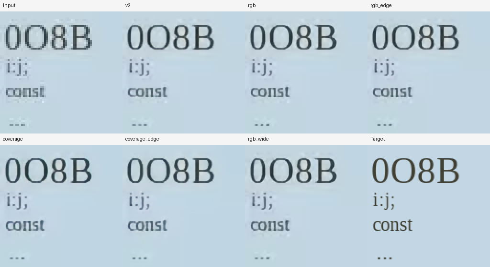
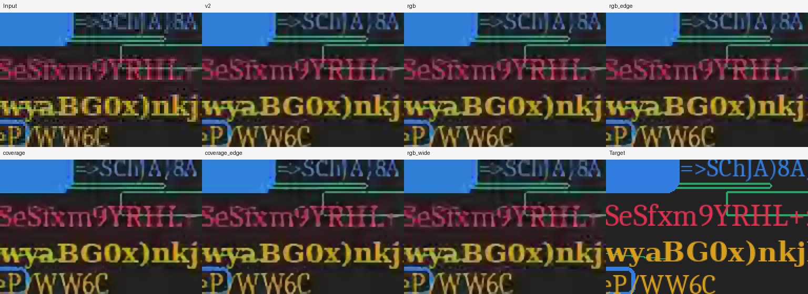
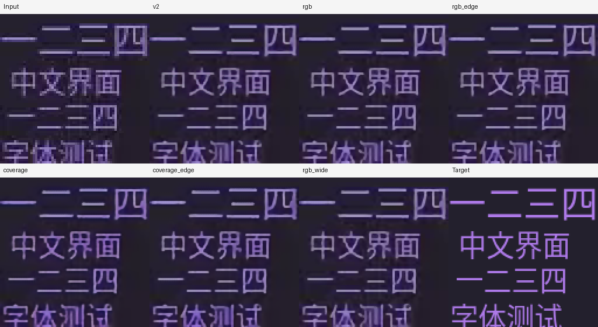

# Coverage-based screen upscaler experiment

This experiment tests whether a small screen upscaler benefits from predicting
glyph coverage separately from color. It also tests a fusible edge-oriented
parameterization and includes RGB controls trained on identical batches.

## Result and decision

**The coverage prototype is implemented and trained, but it is not a production
upgrade.** The strongest result is the edge-trained RGB control, which retains
the shipped 11,468-parameter inference architecture. Two independent anonymous
visual reviews did not find a consistent winner over the shipped model. Bundled
weights remain unchanged.

| Model | Selected updates | Validation score ↓ | Old 9 groups: mean ΔPSNR | Fresh outline: mean ΔPSNR | CJK probe: mean ΔPSNR |
| --- | ---: | ---: | ---: | ---: | ---: |
| Shipped v2 | — | 1.7500 | 0 | 0 | 0 |
| RGB | 16,000 | 1.8326 | −0.105 dB | +0.648 dB | +0.568 dB |
| RGB + edge bases | 20,000 | **1.6746** | −0.069 dB | **+0.814 dB** | **+0.748 dB** |
| Coverage | 20,000 | 2.5375 | −0.192 dB | +0.147 dB | +0.113 dB |
| Coverage + edge bases | 16,000 | 1.8673 | −0.064 dB | +0.540 dB | +0.610 dB |
| Wider RGB | 16,000 | 1.7148 | −0.082 dB | +0.738 dB | +0.666 dB |

These are unweighted averages of group-level PSNR differences, not pooled PSNR.
Each fresh category has four degradations of the same underlying examples.
The improvements are specific to the new rendering tests; old-group accuracy
slightly declines. The edge-trained RGB model beats its matched narrow RGB
control and the wider control on this validation score, but this is one seed
with a documented optimizer restart, not a significance result.

The coverage-plus-edge alpha head learns the synthetic masks reasonably well:
mean absolute coverage error is **0.00897** on fresh native+VP8 outlines. The
full color reconstruction still has serious defects. Its flat-gray probe has
maximum error **13/255** versus zero for v2, and its real-crop halo metric rises
from **1.187 to 2.301**. Plain coverage has a 14/255 flat-gray error. This exposes
a weakness in the learned color/blending path despite useful mask predictions;
it does not establish that every coverage-based architecture will fail.

The edge-trained RGB candidate reduces gray-text color-spread RMS **47.0%** and
the real-crop halo metric **10.1%**. Flat grays and integer-pan checks stay exact.
However, its VP8 temporal error increases from **0.7260 to 0.7442** output levels,
and real-crop edge energy decreases slightly from 61.5607 to 61.0972. Neither its
scores nor the visual reviews support a claim of large-model sharpness.

For 480×270 input, fused PyTorch median FP16 inference is 2.274 ms for v2,
2.254 ms for edge-trained RGB, and 2.911 ms for coverage-plus-edge. Treat the tiny
RGB timing difference as measurement variation: their deployed operation graphs
match. Coverage is about 28% slower in this test. These are not WGSL timings.

The compatible RGB-edge export also passes the actual application shader tests
on the RTX 3060 in native FP16 and forced FP32: maximum CPU/GPU error **1/255**
across the tiled, edge, and unchanged 4× cases; alpha checks pass. Coverage fusion
and tiling are verified in PyTorch, but the new heads have not been ported into
the production shader.

Full per-group results, hashes, checkpoint provenance, GPU logs, and visual-review
records are in [the results JSON](upscaler-coverage-results.json). Candidate
checkpoints and the image-upscaling CLI work under
`ignore/upscaler-coverage-final/`; `rgb_edge-2x.f32` is the compatible shader
candidate, and `coverage_edge-fused.pt` is the new architecture prototype.

## Visual inspection

Both reviewers treated most candidate differences as ties or uncertain. They
agreed that fine punctuation and thin outline/CJK strokes remain less clean than
the targets, all candidates retain substantial smearing in the multicolor UI
example, and real settings text looks sharper than bilinear without a reliable
candidate-to-candidate winner. Real photo texture has no HR reference, so apparent
extra detail cannot be verified. The primary agent inspected the same failure
types and checked the reviewers' filename associations; one review's initial
association error was corrected by reopening the files individually.

The anonymous review used A=wider RGB, B=coverage+edges, C=RGB, D=shipped v2,
E=coverage, F=RGB+edges. Those identities and numeric scores were withheld until
the reviews were complete. The labeled panels below show: top row Input, v2,
RGB, RGB+edges; bottom Coverage, Coverage+edges, Wider RGB, Target.







Real-recording panels stay in the local ignored experiment directory and are not
copied into this report. The independent reviewers are LLM sub-agents; their
observations are qualitative and do not substitute for a human study or OCR.

## Architecture and controls

All models process low-resolution pixels, with a head, four hidden 3×3
convolutions, ReLU, and a skip from the head to the output heads. RGB variants
predict a pixel-shuffled residual over bilinear interpolation. Coverage variants
add a scalar coverage map shared by RGB, two RGB color endpoints, and a scalar
blend gate. The endpoints are interpolated from the low-resolution grid; coverage
and gate are pixel-shuffled to 2× resolution.

```text
geometry = alpha × foreground + (1 − alpha) × background
output   = gate × geometry + (1 − gate) × RGB_reconstruction
```

The extra branch is a two-color reconstruction prior, not character recognition
or vector tracing. It currently produces a fixed 2× coverage mask, not a
continuous distance field or arbitrary-scale decoder. Its color heads and RGB
fallback are learned, so sharing coverage does not guarantee grayscale neutrality.
For synthetic supervision, the two color endpoints are ordered by mean brightness;
alpha can describe the bright background rather than the ink in dark-text cases.

| Variant | Channels | Training parameters | Deployed parameters | Conv MACs/input pixel |
| --- | ---: | ---: | ---: | ---: |
| RGB | 16 | 11,468 | 11,468 | 11,376 |
| RGB + edge bases | 16 | 15,756 | 11,468 | 11,376 |
| Coverage | 16 | 13,498 | 13,498 | 13,392 |
| Coverage + edge bases | 16 | 17,786 | 13,498 | 13,392 |
| Wider RGB control | 18 | 14,196 | 14,196 | 14,094 |

The coverage models use about 18% more convolution MACs than the narrow RGB
control, plus blending/interpolation/sigmoid work. The wider RGB control checks
whether improvements could instead come from a modest capacity increase.

Edge variants add learned coefficients of horizontal/vertical Sobel, Laplacian,
and center-impulse bases to each encoder convolution. These linear additions are
merged into a single kernel for deployment. This is inspired by
[ECBSR](https://www4.comp.polyu.edu.hk/~cslzhang/paper/MM21_ECBSR.pdf), not a full
reproduction of its block. Equivalent-kernel computation also avoids different
padding behavior between training branches and the fused inference convolution.

## Data and training

The existing documentation, code, and procedural-scene training images are
retained. Each batch contains 24 fresh 48×48 crops from those images and eight
coverage-supervised pairs from a new bank of 4,096 examples. All five variants
receive identical batches. The narrow models start with identical encoder and
RGB-head weights; edge coefficients start at zero.

The new generator uses FreeType to hint a glyph at the source pixel size, copy
its outline, scale that already-hinted outline, and rasterize it at 2×. Thus the
paired target preserves the source's hinted shape instead of changing hinting at
the higher size. A second input is area-downsampled from the HR target. Native
and downsampled inputs each have clean and VP8/yuv420p q28 variants. Exact alpha
masks and foreground/background colors supply additional supervision. Geometric
outlines, light/dark backgrounds, colored text, and fractional pixel phases are
included. This is a controlled synthetic model of rendering; it does not cover
every browser's antialiasing or subpixel layout.

Training uses FP32 with TF32 disabled, Adam, batch 32, and a OneCycle learning
rate initially scheduled for 20,000 steps with a peak of 0.001. Initialization
seed is 2604; initial sampling seed is 2601105. That process exited with code 143
after its last logged step at 16,750, before optimizer-state snapshots existed.
All five best saved checkpoints were at step 16,000. Each received the same
4,000-step continuation with freshly initialized Adam, OneCycle peak 0.0001,
and sampling seed 2601106. This is a documented optimizer restart, not an exact
resume of the interrupted run. Selected model paths have up to 20,000 updates.
The base loss is Charbonnier + gradient L1 + source backprojection L1.
Coverage models additionally supervise alpha, alpha gradients, endpoint colors,
the geometry branch, the fallback branch, and a detached per-pixel branch-quality
target for the gate. Thus coverage comparisons test the representation together
with its auxiliary supervision; they do not isolate architecture from loss.

## Evaluation protocol

Selection uses only the existing nine validation crop groups and four new
coverage-validation groups (128 examples). The score is the previous experiment's
normalized edge/stroke/MSE score with PSNR/halo penalties; shipped v2 scores 1.75.
No conclusions are drawn from the raw training-loss magnitudes, which differ
between RGB and coverage models. The test command freezes all model hashes before
opening either existing or fresh test data.

Final checks cover existing held-out docs/code/UI, fresh same-outline pairs,
a CJK probe, grayscale artifacts, coverage errors, halos on existing
real-recording crops, and synthetic/VP8 temporal probes. The old test groups and
real crops have been examined in previous experiments; fresh test seeds start at
3,300,000 and CJK at 3,310,000. Validation seeds start at 3,200,000 and training at
3,100,000. Original browser data has no font-family holdout; procedural font lists
are disjoint between training and validation/test.
The CJK font is absent from procedural training, but exposure through the original
browser-rendered training data has not been ruled out. Coverage/area diagnostics
use known test colors and the minority mask region as an ink proxy; they are not
character recognition or a general stroke-width estimator.

At the user's request, visual validation uses the primary agent and two
independent small sub-agents, not Tesseract. Reviewers see anonymous candidate
labels without metric scores or model identities. These are qualitative reviews,
not human preference studies or measured OCR accuracy. The early 2,000-step
review found no clear winner, with shared ellipsis color errors, edge fringes,
and halos; no training changes were made in response.

Four numerical tests cover nonzero edge-basis fusion and input gradients,
matched initialization, full-image versus tiled inference, and exact color/mask
recomposition of the generated pairs. GPU timings use fused PyTorch models with
the same image size and backend; they are not production WGSL timings. The new
coverage heads require a different runtime graph from the bundled shader.

## Reproduction

Use the local CUDA environment with NumPy, Pillow, Pygments, freetype-py, and
ffmpeg; original datasets must already exist. The experiment uses freetype-py
2.5.1. Use a fresh output directory to repeat training.

```sh
PY=ignore/ui-upscale-distill-venv/bin/python
$PY -m unittest discover -s tools -p test_ui_coverage.py
$PY tools/build_ui_coverage_data.py
$PY tools/train_ui_coverage.py train --stop-after 16000
$PY tools/train_ui_coverage.py train --warm-start ignore/upscaler-coverage \
  --steps 4000 --lr 0.0001 --sampling-seed 2601106 \
  --out ignore/upscaler-coverage-final
$PY tools/train_ui_coverage.py evaluate --out ignore/upscaler-coverage-final
$PY tools/train_ui_coverage.py infer --out ignore/upscaler-coverage-final \
  --model coverage_edge \
  --input source.png --output enhanced.png
```

The inference command uses a fused checkpoint, overlaps tiles by eight input
pixels, and interpolates source alpha separately. It does not modify application
assets. Fused edge blocks retain ordinary 3×3 convolution kernels, but the
coverage color/alpha/gate heads are not compatible with the old flat RGB weights.
The tool now also saves atomic `resume.pt` snapshots containing all current model
weights, optimizer/scheduler states, sampling and PyTorch RNG states, validation
history, and configuration. A future interrupted run can use `--resume` with the
same arguments; `--stop-after` allows clean execution in bounded chunks.
