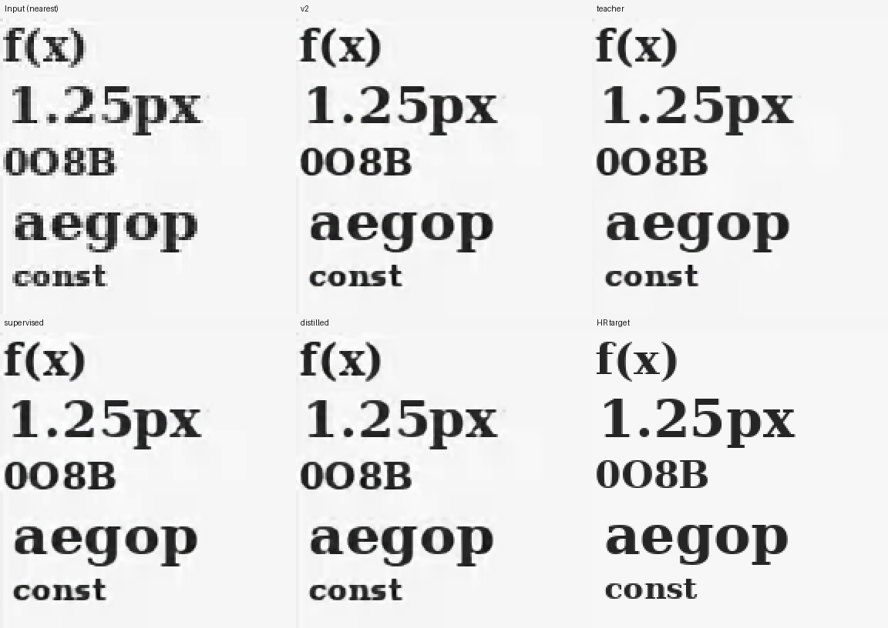
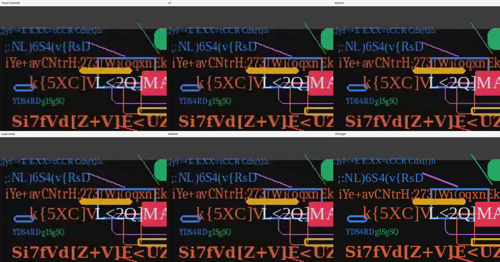

# Distilling a UI upscaler into 11,468 parameters

This experiment trains a larger UI-specific teacher and compares two identical
small students: supervised reconstruction, and reconstruction plus teacher
guidance. Both students retain the shipped 2× model's 16 channels, six layers,
11,468 parameters, and shader weight layout. The teacher is used only for
training and evaluation.

## Result and decision

**Keep the shipped weights.** The distilled student produces substantially less
false color on the grayscale text probe, but does not reproduce the larger
teacher's reconstruction gains. It is a useful experimental candidate, not an
established sharpness upgrade. This extends the earlier
[direct weight-edit experiment](upscaler-weight-edit.md) with training; it is not
evidence that weight editing alone can give a tiny model large-model quality.

Both students completed 20,000 training steps; validation selected step 17,000
for each. Lower selection scores are better: shipped v2 **1.7500**, supervised
**1.7464**, distilled **1.7582**. The supervised control is effectively tied with
v2, and adding teacher guidance did not improve its aggregate score. There is
one final training seed, so these small differences are not significance claims.

Full-image test PSNR (dB, higher is better):

| Test group | Shipped v2 | Teacher | Supervised | Distilled |
| --- | ---: | ---: | ---: | ---: |
| Docs, native | 22.347 | 22.294 | 22.310 | 22.275 |
| Docs, native + VP8 | 22.318 | 22.304 | 22.296 | 22.278 |
| Docs, downsampled + VP8 | 32.167 | 32.902 | 32.194 | 32.187 |
| Scenes, native | 21.221 | 21.149 | 21.252 | 21.173 |
| Scenes, native + VP8 | 20.167 | 20.261 | 20.169 | 20.128 |
| Scenes, downsampled + VP8 | 23.438 | 23.924 | 23.434 | 23.413 |
| Code, native | 21.366 | 21.298 | 21.358 | 21.277 |
| Code, native + VP8 | 20.776 | 20.795 | 20.771 | 20.732 |
| Code, downsampled + VP8 | 27.288 | 27.916 | 27.304 | 27.206 |
| Fresh glyphs, native | 20.868 | 20.851 | 20.910 | 20.873 |
| Fresh glyphs + VP8 | 20.873 | 20.880 | 20.906 | 20.881 |
| Fresh UI, native | 21.319 | 21.232 | 21.347 | 21.262 |
| Fresh UI + VP8 | 20.573 | 20.642 | 20.577 | 20.521 |

On downsampled documentation, the teacher gains **0.735 dB** and reduces edge
error **17.45%** versus v2. The distilled student gains **0.019 dB** and reduces
edge error **1.84%**; the supervised control is slightly better on both metrics.
The distilled student loses PSNR in ten of thirteen groups, including every
native docs/code/UI group. PSNR measures reconstruction, not perceived sharpness;
the edge metrics and comparison images also fail to establish a broad upgrade.

| Additional measurement | Shipped v2 | Supervised | Distilled |
| --- | ---: | ---: | ---: |
| Gray-text channel-spread RMS, 8-bit levels | 1.2162 | 0.8048 | 0.3722 |
| Gray-text maximum channel spread, 8-bit levels | 21 | 15 | 5 |
| Real-recording halo, existing metric ×1000 | 1.1872 | 1.1575 | 1.0135 |
| Real-recording contrast retention | 0.97057 | 0.97233 | 0.97038 |
| Real-recording edge energy | 61.5607 | 61.3986 | 61.1793 |
| Synthetic pan error, 8-bit levels | 2.0384 | 2.0528 | 2.0799 |
| VP8 pan excess temporal error, 8-bit levels | 0.7260 | 0.7493 | 0.7552 |

The distilled candidate reduces gray-text false-color RMS **69.4%** and the
real-crop halo proxy **14.6%**, but edge energy does not increase and both pan
errors get slightly worse. All 256 flat grays and the integer-pan check remain
exact after quantization for both students. These are limited probes, not OCR
accuracy or a comprehensive motion benchmark.

Both exported students have 11,468 parameters and occupy 46,448 bytes including
the shader layout's zero padding. Their
independent NumPy layout checks have maximum errors below 2.1×10⁻⁷. Both pass
the actual RTX 3060 tiled shader tests in native FP16 and forced FP32, with
maximum CPU/GPU differences of **1/255** across the tested cases; alpha checks
also pass. The existing four Rust unit tests and five Python numerical tests
pass. No bundled model weights or inference operations were changed.

Full metrics, selected validation checkpoints, training metadata, hashes, and
GPU logs are preserved in [the results JSON](upscaler-distillation-results.json).
The local candidates are `ignore/upscaler-distill-stream/distilled-2x.f32` and
`ignore/upscaler-distill-stream/supervised-2x.f32`.

The fixed-seed comparisons use identical magnification. Top row: nearest input,
v2, teacher. Bottom row: supervised, distilled, independently rendered HR target.
The remaining six panels are in the local experiment directory.





## Method

The teacher has 64 channels, ten layers, and 304,140 parameters. It starts from
the existing `2x-c24-l7-sharp` checkpoint: the original 24 feature channels are
copied into the wider network, additional body layers initially implement the
identity, and the extra tail inputs initially have zero weight. An assertion
checks that this initialization reproduces the source network's outputs.

Training uses our rendered documentation, code, terminals, and UI scenes,
including native and area-downsampled inputs with VP8 compression. An additional
1,024 procedural typography pairs cover small text, punctuation, narrow gaps,
and easily confused glyphs. They are rendered independently at native 1× and 2×
using Pillow; these are exact render pairs, not generative-image approximations.
Half the added low-resolution images pass through VP8/yuv420p at quality 28.

The teacher first trains for 8,000 steps with Charbonnier error, gradient L1,
backprojection L1, and a small halo penalty. A 4,000-step continuation adds a
gradient constraint on the area-downsampled prediction to preserve the clean
source's contrast. Each stage keeps its best validation checkpoint, not
necessarily its last step.

The final comparison uses the original small-model training recipe: FP32,
20,000 steps, batch 32, Adam with OneCycle learning rate peaking at 0.001,
Charbonnier + gradient L1 + backprojection L1, and initialization seed 2604.
Every batch contains 30 fresh crops from the full original training images and
two generated typography crops. The same batch and initial weights go to both
students. The distilled student additionally matches the frozen teacher's
outputs and gradients. This is output/gradient distillation, not a reproduction
of the feature-distillation method in the [ECCV paper](https://www.ecva.net/papers/eccv_2020/papers_ECCV/html/4644_ECCV_2020_paper.php).

Initial cached-crop experiments explored fine-tuning and stronger source-contrast
constraints. Those failed validation: gains on some glyph examples came with
worse stroke contrast or documentation reconstruction. They were not promoted.
Their logs and checkpoints remain in `ignore/upscaler-distill`,
`ignore/upscaler-distill-contrast`, and `ignore/upscaler-distill-scratch`.

## Evaluation protocol

Selection uses the existing validation split plus 96 generated typography pairs.
The selection score combines normalized edge error, stroke error, and MSE, with
penalties for PSNR regressions beyond 0.15 dB and increased halos. Runs with the
source-gradient objective also include that metric in selection; scores from
different objectives should not be compared directly.

Hashes of all selected weights are written before opening test data. Final
evaluation includes all nine existing source/degradation test groups, 128 fresh
typography pairs, and 32 fresh UI scenes. Procedural evaluation font files are
excluded from the procedural training font list; browser-rendered docs/code do
not have a font-family holdout. Validation and test share the held-out procedural
fonts but use disjoint seeds. Generated seed ranges start at 2,100,000 for training, 2,200,000
for validation, 2,300,000 for test glyphs, and 2,400,000 for test UI.

Additional checks cover flat grays, grayscale color fringes, source contrast,
halos on existing real-recording crops, and temporal error. A synthetic pan is
encoded through interframe VP8; its motion-compensated error is compared with
known high-resolution motion. This is an encoded synthetic sequence, not an
evaluation of arbitrary real recording motion. OCR accuracy is not measured.
The nine original groups and real crops are existing repository evaluation data,
also used in the preceding weight-edit study; only the additional glyph/UI seed
ranges are new. Model selection here uses validation, not either test set.
Original-group metrics are averaged over four-image batches (blank batches are
excluded from stroke error), with PSNR recomputed from aggregate MSE. Real-crop
crispness uses clamped float predictions; paired and temporal metrics use 8-bit
quantization. Halo units differ between the real-crop and paired-image helpers.

The shared integer-pan probe trims 16 HR pixels, sufficient for the small
students but not the wider teacher's ten-layer receptive field. Its recorded
one-level teacher discrepancy may include boundary effects and should not be
interpreted as a teacher translation-equivariance failure. The teacher is a
304k-parameter model trained here, not a pretrained state-of-the-art large model.

The exported student coefficients are checked against the independent NumPy
oracle. The Rust hardware test accepts `LAHZA_UPSCALE_WEIGHTS_2X` to exercise
candidate weights, tiled inference, image edges, and alpha preservation without
replacing bundled assets. This override exists only in test code.

## Reproduction

Use a CUDA PyTorch environment with NumPy, Pillow, Pygments, and ffmpeg. The run
used PyTorch 2.14.1+cu130 on an RTX 3060. The dataset and source teacher checkpoint
must already exist; their original training is documented in
[`assets/upscaler/README.md`](../assets/upscaler/README.md).

The experiment tool is [`tools/distill_ui_upscaler.py`](../tools/distill_ui_upscaler.py).
Use fresh output directories for independent experiments. The selected teacher
checkpoint is local at `ignore/upscaler-distill-contrast/teacher.pt`; the final
student run and comparisons are under `ignore/upscaler-distill-stream/`.

```sh
python tools/distill_ui_upscaler.py prepare
python tools/distill_ui_upscaler.py train --stage teacher

# Prepare the continuation directory with the same generated training data.
python tools/distill_ui_upscaler.py prepare --out ignore/upscaler-distill-contrast
python tools/distill_ui_upscaler.py train --stage teacher --teacher-steps 4000 \
  --lr 0.00005 --source-gradient 2 \
  --teacher-start ignore/upscaler-distill/teacher.pt \
  --out ignore/upscaler-distill-contrast

python tools/distill_ui_upscaler.py prepare --crops-per-source 4096 \
  --out ignore/upscaler-distill-stream
cp ignore/upscaler-distill-contrast/teacher.pt ignore/upscaler-distill-stream/teacher.pt
python tools/distill_ui_upscaler.py train --stage students --scratch --streaming \
  --student-steps 20000 --lr 0.001 --schedule onecycle --fp32-students \
  --grayscale-rate 0 --edge-weight 1 --halo-weight 0 --kd-weight 2 \
  --out ignore/upscaler-distill-stream
python tools/distill_ui_upscaler.py evaluate --out ignore/upscaler-distill-stream

LAHZA_UPSCALE_WEIGHTS_2X="$PWD/ignore/upscaler-distill-stream/distilled-2x.f32" \
  cargo test -p lahza-screen-upscale --release \
  hardware_neural_tiles_match_cpu_reference_for_2x_and_4x \
  -- --ignored --test-threads=1 --nocapture

# Repeat with LAHZA_UPSCALE_F32=1 for the full-precision shader path.
```

Model hashes and source/data provenance should accompany any published result.
Fixed seeds do not guarantee bitwise identical CUDA training across environments.
The final streaming run uses only the last 1,024 generated pairs from its cached
bank; original-image crops are sampled afresh. Thus the bank's 12,288 cached
original crops are unused in that run. Teacher guidance is computed in FP16
while both final students train in FP32.
